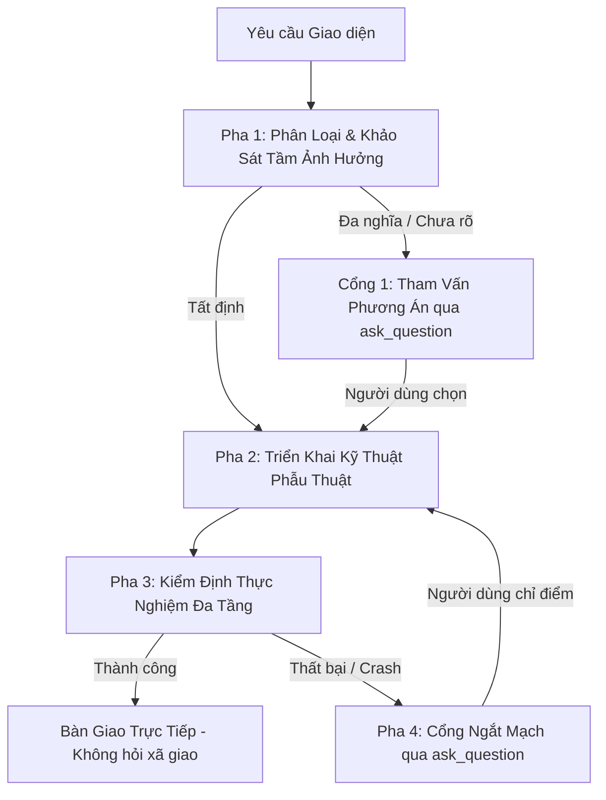

# UI Engineering Flow & Verification Protocol

Quy trình kỹ thuật toàn diện cho kỹ thuật giao diện web: phân tầng dữ liệu, cấu trúc component phòng vệ, kiểm định thực tế và điều phối tương tác người dùng.

---

## 1. BẢNG CHỈ ĐIỂM TÀI NGUYÊN (PROGRESSIVE DISCLOSURE)

> **CẢNH BÁO CHO AGENT**: KHÔNG nạp toàn bộ tài liệu tham khảo cùng lúc. Chỉ đọc duy nhất tệp tương ứng với phạm vi kỹ thuật của bài toán hiện tại:

| Phạm vi kỹ thuật cần giải quyết | Tài liệu tham khảo tương ứng (Chỉ đọc khi cần) |
| :--- | :--- |
| **Kiến trúc Component**: Phân rã component lớn (>150 dòng), tách logic/view, Compound & Slot pattern | [component-architecture.md](./references/component-architecture.md) |
| **Quản lý Dữ liệu & State**: Đồng bộ URL params, Cache Server, Form lifecycle, tối ưu re-render | [state-taxonomy.md](./references/state-taxonomy.md) |
| **Bố cục & Styling Phòng Vệ**: Chống vỡ Flexbox/Grid, phân tầng z-index, chống co giật layout (CLS), sub-pixel rendering | [defensive-layout.md](./references/defensive-layout.md) |
| **Công cụ Kiểm định Runtime**: Kiểm tra WSOD (màn hình trắng), Runtime Error Overlay, Console log qua Chromium | [audit-ui.js](./scripts/audit-ui.js) |

---

## 2. CÁC NGUYÊN TẮC CỐT TỬ (THE INVARIANTS)

### Invariant 1: Phân Loại Yêu Cầu Đầu Vào (Input Classification)
- **Yêu cầu Tất định (Deterministic Directives)**: 
  - Đặc điểm: Có đối tượng thao tác rõ ràng và hành động cụ thể, đơn nghĩa.
  - Hành động: **Thực thi ngay bằng code**. Nghiêm cấm hỏi lại hoặc yêu cầu giải thích thêm.
- **Yêu cầu Đa nghĩa / Định hướng / Bác bỏ (Exploratory / Directional / Rejection)**:
  - Đặc điểm: Yêu cầu trừu tượng, thay đổi phong cách hiển thị, hoặc từ chối kết quả trước mà chưa cung cấp đặc tả kỹ thuật thay thế.
  - Hành động: **CẤM tự đoán mò giải pháp**. Bắt buộc dừng lại, sử dụng `ask_question` để đề xuất 2–3 phương án kỹ thuật khả thi kèm đánh giá tradeoff để người dùng quyết định hướng đi.

### Invariant 2: Kỷ Luật Công Cụ & Tính Trung Thực (Tool Discipline & Integrity)
- **Sửa code minh bạch**: Mọi thay đổi mã nguồn bắt buộc sử dụng công cụ `replace_file_content` hoặc `write_to_file`. Nghiêm cấm dùng script chạy ngầm (PowerShell/Bash) để thay thế chuỗi tự động làm rách cú pháp và mất dấu vết diff.
- **Báo cáo chuẩn xác (Grounded Truth)**: Mọi kết luận kỹ thuật phải đối chiếu trực tiếp với `git status` và `git diff`. Nghiêm cấm phóng đại hoặc bịa đặt số lượng tệp và kết quả kiểm định.

### Invariant 3: Chốt Chặn Biên Dịch Cứng (Hard Compilation Gate)
- Trước khi công bố kết quả kiểm định, bắt buộc phải chạy lệnh kiểm tra biên dịch (`build` hoặc `typecheck`).
- Nếu quá trình biên dịch có lỗi (lỗi cú pháp, phân tích AST, hoặc lỗi kiểu): **CẤM báo cáo thành công**. Phải khắc phục triệt để lỗi biên dịch trước khi thực hiện bất kỳ bước nào khác.

### Invariant 4: Ngắt Mạch Khi Thất Bại (Circuit Breaker)
- Nếu kiểm định runtime phát hiện lỗi nghiêm trọng (màn hình trắng, bảng báo lỗi runtime, không mount được thành phần):
  - **Dừng can thiệp đơn phương**: Cấm tự ý sửa đổi tiếp tục theo phán đoán chủ quan.
  - **Tham vấn chẩn đoán**: Trích xuất triệu chứng và dùng `ask_question` để xác định chính xác tầng lỗi với người dùng.

### Invariant 5: Khép Kín Hành Động Sau Khi Hỏi (Action-on-Response)
- Khi nhận phản hồi từ người dùng sau câu hỏi `ask_question`:
  - **Chuyển hóa thành hành động ngay**: Phản hồi của người dùng là chỉ đạo trực tiếp để thực hiện bước kỹ thuật tiếp theo.
  - **Cấm trạng thái mồ côi**: Tuyệt đối không dừng lại ở câu giao tiếp xã giao mà không kích hoạt thao tác code tương ứng.

---

## 3. QUY TRÌNH THỰC THI 4 PHA

### Pha 1: Phân Loại & Khảo Sát Phạm Vi
1. Khảo sát call-sites và hợp đồng dữ liệu liên quan.
2. Kiểm tra tính tất định của yêu cầu:
   - Nếu đã rõ ràng $\rightarrow$ Bước sang Pha 2.
   - Nếu thuộc dạng đa nghĩa, đổi phong cách, hoặc bác bỏ lần trước $\rightarrow$ Gọi `ask_question` đề xuất các phương án kỹ thuật.

### Pha 2: Triển Khai Kỹ Thuật Phẫu Thuật
1. Tham chiếu tài liệu kỹ thuật tương ứng từ Bảng Chỉ Điểm (nếu cần).
2. Chỉnh sửa tối thiểu, đúng trọng tâm, bảo toàn hợp đồng hiện có.
3. Sử dụng công cụ `replace_file_content` có kiểm soát diff.

### Pha 3: Kiểm Định Thực Nghiệm Đa Tầng & Bàn Giao
1. **Tầng 1 (Biên dịch cú pháp)**: Chạy lệnh build/typecheck dự án (`npm run build` hoặc `tsc --noEmit`). Bắt buộc đạt exit code 0.
2. **Tầng 2 (Thực nghiệm Runtime & Thị giác)**:
   - **Cấm kiểm định bề mặt**: Không chấp nhận `children.length > 0` hay `innerText > 0` làm bằng chứng.
   - **Đo lường hình học thực tế**: Bắt buộc kiểm tra BoundingClientRect (`rect.width > 0 && rect.height > 0`) và computed styles (`visibility !== 'hidden'`, `opacity !== '0'`).
   - **Bắt sụp đổ ngầm**: Quét sạch các lớp báo lỗi (`vite-error-overlay`, `nextjs-portal`, `[data-react-error-boundary]`), Unhandled Promise Rejections và Console errors.
   - **Bằng chứng thị giác**: Lưu ảnh chụp màn hình thực tế hoặc layout dump vào `.audit/`.
3. **Bàn giao**:
   - Nếu kiểm định pass: Xuất báo cáo tóm tắt các tệp thay đổi và bằng chứng thực nghiệm cụ thể (kích thước render, trạng thái overlay, ảnh chụp). Kết thúc lượt làm việc để người dùng trải nghiệm thực tế. **Tuyệt đối cấm tạo câu hỏi xác nhận vô bổ chỉ để đáp lại lời khen**.
   - Nếu kiểm định fail: Chuyển ngay sang Pha 4.

### Pha 4: Ngắt Mạch Sự Cố
1. Không tự ý chỉnh sửa lại code khi chưa hiểu rõ nguyên nhân sụp đổ.
2. Cung cấp log lỗi thực tế và gọi `ask_question` để làm rõ tầng nguyên nhân với người dùng.
3. Khi nhận được phản hồi, quay lại Pha 2 để xử lý dứt điểm.

---

## 4. QUY CHUẨN GIAO TIẾP VỚI TOOL `ask_question`

Khi sử dụng tool `ask_question` trong agy, bắt buộc tuân thủ:
1. **Trường `question`**: Phải là một câu hỏi trực diện, súc tích (dưới 15 từ). CẤM đưa báo cáo, danh sách thay đổi hoặc ký tự xuống dòng `\n` vào trường này. Mọi báo cáo kỹ thuật phải in ra trước đó bằng văn bản markdown chat.
2. **Trường `options`**: Các lựa chọn phải ngắn gọn, gắn liền với bản chất kỹ thuật cụ thể (ưu/nhược điểm rõ ràng), định dạng theo ngôi thứ nhất của người dùng (e.g. "Dùng nuqs đồng bộ URL", "Dùng local state").
3. Không tự thêm tùy chọn 'Other' (UI đã tự có). Không đánh số thứ tự trong options.
