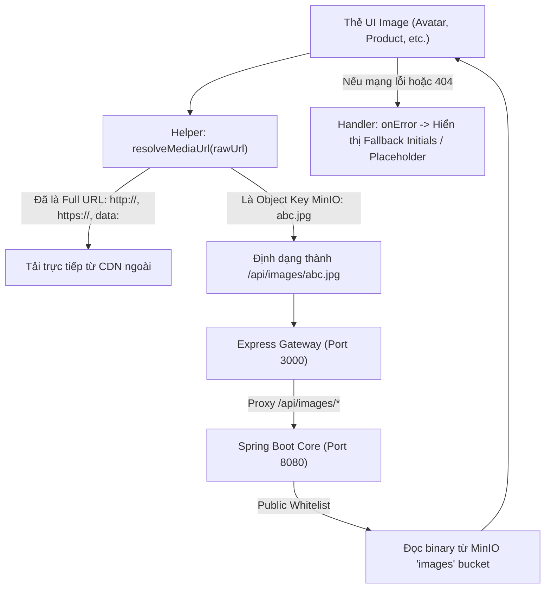

# Đặc tả Kỹ thuật: Cơ chế Phục vụ và Phân giải Ảnh Đa phương tiện (Media Asset Resolution)

- **Trạng thái**: Proposed / Under Review
- **Mã định danh**: SPEC-004-MEDIA-RESOLUTION
- **Ngày lập**: 2026-10-13
- **Tác vụ liên quan**: Điều tra lỗi vỡ hình ảnh đại diện (User Avatar) và bất đồng bộ hiển thị hình ảnh trên toàn hệ thống

---

## 1. Bối cảnh & Hiện trạng Sự cố (Investigation Facts)

Người dùng phản ánh hiện tượng: Một số hình ảnh hiển thị bình thường, trong khi một số hình ảnh khác (cụ thể là Avatar trên Navbar, Avatar trên trang Profile, và Avatar trong modal "Trung tâm tài khoản") bị vỡ và hiển thị biểu tượng ảnh hỏng cùng văn bản `alt`.

### 1.1. Dữ liệu thực nghiệm thu thập từ hệ thống
1. **API `/api/auth/me` (Spring Boot port 8080)**:
   - Dữ liệu trả về cho tài khoản `ADMIN@gmail.com`:
     ```json
     {
       "status": { "code": 200, "message": "Success" },
       "data": {
         "id": "1",
         "username": "ADMIN",
         "fullName": "Ngô Ngọc Định",
         "email": "ADMIN@gmail.com",
         "avatarUrl": "f9a83325-2c26-4111-b24c-7dcd9f45cb56.jpg",
         "rank": "MEMBER",
         "status": "ACTIVE"
       }
     }
     ```
   - Nhận xét: `avatarUrl` trả về là một **Object Key trần** (`f9a83325-2c26-4111-b24c-7dcd9f45cb56.jpg`), không có giao thức (`http://`, `https://`) và không có đường dẫn API (`/api/...`).

2. **Cơ chế lưu trữ trên MinIO Object Storage (port 9000)**:
   - File `f9a83325-2c26-4111-b24c-7dcd9f45cb56.jpg` **thực sự tồn tại** trong bucket `images` của MinIO.
   - Thử nghiệm truy cập trực tiếp `http://localhost:9000/images/f9a83325-2c26-4111-b24c-7dcd9f45cb56.jpg`: Trả về `403 Forbidden` (MinIO mặc định đóng quyền public bucket).

3. **Cơ chế xem ảnh trên Spring Boot (`MerchandiseController.java`)**:
   - Spring Boot có endpoint phục vụ ảnh: `GET /api/merchandise/view-image/{imageName}`.
   - Thử nghiệm với header `Authorization: Bearer <token>`: Trả về **`HTTP 200`** kèm dữ liệu binary ảnh đầy đủ.
   - Thử nghiệm **không có** header `Authorization`: Trả về **`HTTP 403 Forbidden`**.

4. **Lệch cấu hình Spring Security (`SecurityConfiguration.java`)**:
   - Mảng `PUBLIC_BUSINESS_ENDPOINTS` khai báo whitelist cho: `"/api/images/**"`.
   - Tuy nhiên, trong mã nguồn không hề có Controller nào map vào `/api/images/**`. Controller duy nhất tải ảnh lại nằm ở `/api/merchandise/view-image/**`, và endpoint này không nằm trong danh sách whitelist công khai.

5. **Trình duyệt Web và Express Gateway (`server.ts` port 3000)**:
   - Frontend render thẻ HTML: ``.
   - Với giá trị `src="f9a83325-2c26-4111-b24c-7dcd9f45cb56.jpg"`, trình duyệt gửi request relative:
     `GET http://localhost:3000/f9a83325-2c26-4111-b24c-7dcd9f45cb56.jpg`.
   - Express/Vite trên port 3000 không có file tĩnh này, fallback về route SPA: trả về file `index.html` với header `Content-Type: text/html; charset=UTF-8` và status `200 OK`.
   - Trình duyệt cố giải mã mã nguồn HTML của trang chủ thành định dạng ảnh JPEG -> Giải mã thất bại (Image decode error) -> Kích hoạt biểu tượng ảnh vỡ (Broken image icon).
   - Frontend không có `onError` fallback trên thẻ `img`, khiến giao diện bị phơi bày lỗi vỡ ảnh thô sơ.

---

## 2. Bảng Phân loại Tình trạng Hiển thị (Display Matrix)

| Nhóm hình ảnh | Nguồn cấp | Giá trị chuỗi `src` | Kết quả hiển thị | Nguyên nhân kỹ thuật |
| :--- | :--- | :--- | :--- | :--- |
| **Ảnh Mock / Sản phẩm tĩnh** | Unsplash CDN | `https://images.unsplash.com/photo-...` | ✅ Hiển thị hoàn hảo | Trình duyệt truy cập trực tiếp CDN qua giao thức HTTPS công khai, nhận đúng `Content-Type: image/jpeg`. |
| **Biểu tượng UI / Logo** | Inline SVG / Lucide React | Mã nguồn SVG trong DOM (`<svg>`, `<Sliders />`) | ✅ Hiển thị hoàn hảo | Render trực tiếp bằng vector code, không thực hiện network request tải file. |
| **Avatar từ Google OAuth** | Google User Info API | `https://lh3.googleusercontent.com/a/...` | ✅ Hiển thị hoàn hảo | Là full HTTPS URL công khai từ server Google. |
| **Avatar người dùng tự upload / ADMIN** | MinIO Object Storage | `f9a83325-2c26-4111-b24c-7dcd9f45cb56.jpg` | ❌ Bị vỡ (Broken) | Chuỗi là object key trần; trình duyệt gọi sai cổng 3000 nhận về HTML thay vì JPEG. |
| **Ảnh sản phẩm upload lên MinIO** | MinIO Object Storage | `uuid-media-key.png` | ❌ Sẽ bị vỡ nếu không fallback sang Unsplash | Tương tự Avatar, thiếu tiền tố endpoint và quyền truy cập công khai. |

---

## 3. Kiến trúc Đề xuất & Kế hoạch Khắc phục (Proposed Solution Architecture)

Để giải quyết triệt để và đồng bộ cho toàn bộ hệ thống (Avatar, Sản phẩm, Banner, Giỏ hàng), đề xuất triển khai 3 lớp xử lý:



### 3.1. Lớp 1: Backend Spring Boot (Chuẩn hóa Endpoint & Quyền truy cập)
1. **Tạo Controller công khai `ImageController`**:
   - Đường dẫn chuẩn: `GET /api/images/{fileName}`.
   - Đọc stream từ `minioService.getFile(fileName)`.
   - Tự động nhận diện `MediaType` dựa trên đuôi file (`.jpg`, `.jpeg`, `.png`, `.webp`, `.svg`, `.gif`).
   - Thiết lập header `Cache-Control: public, max-age=86400` để tối ưu hiệu năng duyệt web.
2. **Cập nhật `SecurityConfiguration.java`**:
   - Xác nhận `"/api/images/**"` nằm trong `PUBLIC_BUSINESS_ENDPOINTS` để thẻ `` của mọi client (không cần Bearer token) đều có thể tải ảnh công khai.

### 3.2. Lớp 2: Express Gateway (`server.ts`)
- Bổ sung proxy chuyển tiếp cho cụm đường dẫn ảnh:
  ```typescript
  app.all(["/api/images*", "/api/merchandise/view-image*"], async (req, res) => {
    // Reverse proxy chuyển tiếp tới http://localhost:8080
  });
  ```

### 3.3. Lớp 3: Frontend Client (Chuẩn hóa URL & Error Boundary)
1. **Hàm tiện ích `resolveMediaUrl(raw?: string): string`**:
   - Nếu rỗng: trả về chuỗi rỗng `""`.
   - Nếu bắt đầu bằng `http://`, `https://`, `data:`, `blob:`: trả về nguyên bản.
   - Nếu là filename hoặc đường dẫn tương đối: nối với `${getApiBaseUrl()}/api/images/${raw.replace(/^\/+/, "")}`.
2. **Xử lý `onError` cho toàn bộ các vị trí hiển thị Avatar và Ảnh sản phẩm**:
   - `Navbar.tsx`: Khi ảnh lỗi, tự động set `imageError = true` và chuyển sang render chữ cái viết tắt đại diện (`avatarInitial`).
   - `ProfilePage.tsx` (cả Hero Header và Modal "Trung tâm tài khoản"): Chuyển sang avatar chữ cái gradient màu thương hiệu Horizon khi ảnh bị lỗi.
